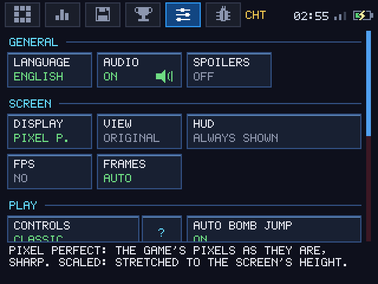
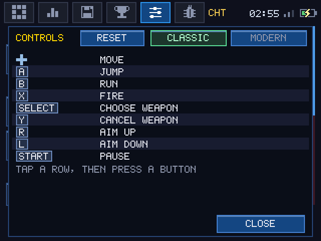

# sm-3ds


A native Nintendo 3DS port of **Super Metroid**, built on
[snesrev's C reimplementation](https://github.com/snesrev/sm) and
[CharlesAverill's 3DS port](https://github.com/CharlesAverill/sm-3ds).
Features **full stereoscopic 3D with per-layer depth** and **widescreen gameplay (400x240)**.

**The ROM is not included.** You need your own copy of Super Metroid.

---

## Status & Features (v0.6.1)

- **Stereoscopic 3D:** True per-layer depth using the 3DS parallax barrier hardware. Runs at a rock-solid **60 fps on New 3DS** and **60 fps in gameplay on Old 3DS / 2DS**.
- **Widescreen Mode (VIEW: WIDE):** Expands the playfield laterally to 336 px, filling the native 5:3 400x240 top screen of the 3DS while keeping enemies and projectiles alive in the extended margins. Original 4:3 (256x224) aspect ratio is also selectable (`VIEW: ORIGINAL`).
- **Modern Controls Scheme:** Play with modern ergonomics (B runs, L aims diagonally, R + X / Y / B fires missiles / super missiles / grapple / X-ray, Y rolls into morph ball) or choose the classic SNES button layout.
- **Touchscreen Bottom UI:**
  - **Status Tab:** Real-time energy, reserve tanks (AUTO / MANUAL), touch weapon selection, and **long-press to equip / unequip items and beams** directly without entering the pause menu. Includes a dedicated "?" help window.
  - **Map Tab:** Detailed vector map with room outlines, zoom levels (1X, 2X, 3X), doors, map stations, and an **item tracker window** counting items found per area (with optional SPOILERS mode).
  - **Save States Tab:** Unlimited save states with in-game screenshot thumbnails, gameplay stats (time, energy, missiles, area), and color marks.
  - **RetroAchievements Tab:** Full RetroAchievements support (softcore) with achievement cards, progress tracking, and on-screen popups (customizable to top or bottom screen).
  - **Options Tab:** Controls scheme, audio toggle, frame pacing (AUTO, LOCK 30, NO SKIP), CPU 804 MHz mode (New 3DS), display modes (Pixel Perfect / Scaled), view modes (Original / WIDE), FPS counter, and language selector.
- **Self-Updater:** Check and install the latest updates directly from the console (OPTIONS -> UPDATES), complete with version notes.
- **Multilingual Support:** English, Spanish, Catalan, French, Portuguese, and Japanese. Custom translations can also be loaded from the SD card (`lang/` folder).
- **Sound:** Authentic emulated SNES SPC700 sound chip playback.

---

## Screenshots

| Widescreen Gameplay (Top Screen) | Status & Item Equipment (Bottom Screen) |
|:---:|:---:|
|  |  |

| Interactive Map & Tracker | Collected Items Tracker (SPOILERS Mode) |
|:---:|:---:|
|  |  |

| Save States List | Save State Detail & Load Window |
|:---:|:---:|
|  |  |

| RetroAchievements | Options & Display Settings |
|:---:|:---:|
|  |  |

| Status Touch Help Window | Controls Help Window |
|:---:|:---:|
|  |  |

---

## Installing

You need a 3DS with custom firmware (e.g. Luma3DS) and FBI or another CIA installer.

1. Download `sm-3ds-<version>.cia` from the
   [Releases page](https://github.com/tinaut1986/sm-3ds/releases), or scan the
   QR code on that page with FBI ("Remote Install" -> "Scan QR Code").
   Releases marked **Beta** are test builds from a release branch.
2. Install the CIA with FBI.
3. Copy your ROM to the SD card, into this folder (create it if needed; the
   game also creates it on first start):

   ```
   sdmc:/3ds/Super Metroid 3DS/
   ```

   Any file name ending in `.smc` or `.sfc` works. Only the **Japan/USA**
   release is accepted: its headerless SHA-1 is
   `da957f0d63d14cb441d215462904c4fa8519c613`. A 512-byte copier header is
   stripped automatically. PAL and translation-patched ROMs are rejected; the
   game shows an error screen with the expected hash if no valid ROM is found.
4. Start "Super Metroid 3DS Port" from the HOME menu.

**Homebrew Launcher instead of a CIA:** every release also has `sm-3ds-<version>.3dsx`. Copy it to
`sdmc:/3ds/` (any name), put the ROM in the same folder as in step 3 and open it from the Homebrew
Launcher. Saves and settings are the same files as the CIA's. Its updater (OPTIONS -> UPDATES)
downloads the new `.3dsx` over the old one and starts it again (with Luma3DS; with another
launcher it quits to it and you open it again); it never installs anything as a title.

Everything else the game writes lives in the same folder:

| Path | What |
|---|---|
| `saves/sm.srm` | in-game save files (the three save slots) |
| `saves/save0.sav` ... `saveN.sav` | save states (States tab), each with `.png` thumbnail and metadata |
| `config.ini` | options from the bottom screen (language included) |
| `retroachievements.ini` | RetroAchievements on/off, user name and login token |
| `lang/` | custom external language files (`.txt`) |
| `debug/` | logs, perf CSVs and dumps from the Debug tab |

---

## Controls

The port offers two control schemes selectable in **OPTIONS -> CONTROLS** (or by tapping the "?" button beside CONTROLS):

- **CLASSIC:** Maps 3DS buttons directly to original SNES buttons (D-pad/Circle Pad moves, B runs, A jumps, X fires, Select switches weapon, Y cancels weapon, R/L aim diagonally).
- **MODERN:** B runs (as in the original), L aims diagonally, R + X / Y / B fires missiles / super missiles / special weapons, Y rolls into morph ball. Every button can be remapped; on a New 3DS a weapon can go on ZL or ZR instead of R + a button.

**Skipping the intro:** while the intro plays, START opens a choice at the bottom of the screen: go to Ceres station (only the story is skipped) or straight to planet Zebes (Ceres, its tutorial, boss and escape are skipped too). B goes back to the intro.

**Charge beam pulls drops** (off by default; OPTIONS -> PLAY -> CHARGE PULLS DROPS): while the charge beam charges, the health and ammo enemies drop near Samus fly to her and are picked up.

**Auto bomb jump** (both schemes, on by default; OPTIONS -> PLAY -> AUTO BOMB JUMP): hold the bomb button in the morph ball and Samus climbs by herself, laying each bomb on the frame that keeps the infinite bomb jump going. Tapping the button lays bombs as always; letting go stops the climb. It does nothing in water or lava without the Gravity Suit, where bombs barely lift the ball.

The bottom screen is operated entirely by touch:
- **STATUS:** Tap weapons to equip them. **Hold down (0.5s)** on any item or beam to toggle it on/off without pausing. Tap reserve tanks to switch AUTO / MANUAL.
- **MAP:** Tap and drag to explore the map. Tap the zoom button to toggle 1X, 2X, and 3X zoom. Tap the item tracker button to view collected items by area.
- **STATES:** Tap `+ NEW` to save a state. Tap an existing state to open its detail window, load it, overwrite it, or assign a color tag.

---

## Languages

OPTIONS -> LANGUAGE switches the bottom screen and the game's message boxes (items, stations, save prompt) between:
- English
- Spanish (Español)
- Catalan (Català)
- French (Français)
- Portuguese (Português)
- Japanese (日本語)

Custom language files can also be added as UTF-8 text files on the SD card in `sdmc:/3ds/Super Metroid 3DS/lang/` without recompiling the game.

---

## RetroAchievements

The trophy tab connects directly to [RetroAchievements](https://retroachievements.org) (softcore mode). Tap **LOG IN** and enter your credentials using the 3DS software keyboard.
- Unlocks made while offline are automatically queued and synchronized once an internet connection is established.
- Unlock notifications can be displayed as popups on the top screen or over the bottom screen tab bar.

---

## Building

Needs devkitARM with libctru, citro2d/citro3d (the
[devkitPro](https://devkitpro.org/wiki/Getting_Started) `3ds-dev` group) and the
`3ds-curl 3ds-mbedtls 3ds-zlib` portlibs (`dkp-pacman -S 3ds-curl 3ds-mbedtls 3ds-zlib`; the
self-updater needs them), plus `cmake`, `git`, `curl` and Python 3. `makerom` and `bannertool` are committed
in `tools/bin/` (Linux x86-64). No ROM is needed to build.

```sh
git clone https://github.com/tinaut1986/sm-3ds.git
cd sm-3ds
./build_3ds.sh          # interactive: build, optionally find the 3DS and send it
```

Or with make directly:

```sh
make -j FULL_NATIVE=1 cia                              # release CIA
make -j FULL_NATIVE=1 DEBUG_TOOLS=1 cia                # debug build with cheats/teleport
make -j FULL_NATIVE=1 3dsx                             # the Homebrew Launcher build
make -j FULL_NATIVE=1 ftp FTP_HOST=192.168.1.50        # build and upload via FTP
```

---

## Credits and License

- [snesrev](https://github.com/snesrev/sm): the C reimplementation of the game (`sm/`, MIT).
- [Charles Averill](https://github.com/CharlesAverill/sm-3ds): the initial 3DS port skeleton.
- [rcheevos](https://github.com/RetroAchievements/rcheevos): RetroAchievements library (MIT).
- The 5x7 UI font, asset tooling, and UI framework come from the author's [Metroid: Zero Mission 3DS port](https://github.com/tinaut1986/mzm).

Super Metroid is © Nintendo; this project contains no copyrighted game data. Code is licensed under MIT (see `LICENSE`).
